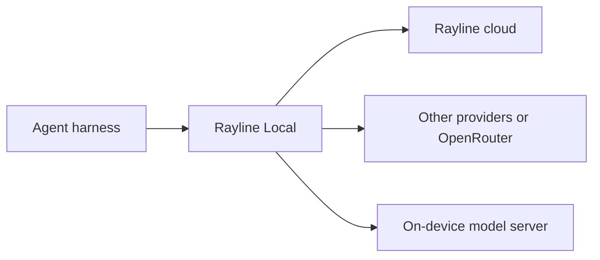

Your agent harness sends requests to an API endpoint to get answers and tool calls. You can connect it directly to **Rayline in the cloud**, or send its requests through **Rayline Local**, a gateway running on your computer.

Start with the direct connection in your [tool's guide](/tools). Use Rayline Local when the guide requires it, or when you want to manage the destinations and routing on your own machine.

<span id="choose-your-connection" />
<span id="connect-through-the-cloud-or-rayline-local" />

## Two ways to connect

### Connect directly to Rayline

**Your agent harness → Rayline cloud → inference model**

Configure your tool with the Rayline API URL, your Rayline API key, and an ARC model ID. Rayline receives the request, ARC chooses the model and reasoning effort, and the selected model generates the answer. You do not need to install a gateway.

You can also use the hosted **Agent Gateway** with [routing rules](/rules-router/policies) that assign models explicitly. ARC and explicit routing rules are different ways to choose a model; either can be reached through Rayline's cloud services.

### Connect through Rayline Local

**Your agent harness → Rayline Local on your computer → configured destination**

Your tool connects to a local address, such as `http://127.0.0.1:23811`. Rayline Local receives the request and forwards it according to your configuration. It can keep upstream API keys in the gateway and apply local routing rules.

Local can forward requests to Rayline's cloud services, but it is not limited to Rayline. You can configure other cloud providers, gateways such as **OpenRouter**, or a model server running on your own hardware. Each destination needs a supported protocol and the appropriate credentials. See [endpoint configuration](https://github.com/rayline-ai/rayline/blob/main/docs/getting-started.md) for supported combinations.



These are destinations you configure. Installing Rayline Local does not automatically enable ARC to choose between all of them.

## Where the work runs

Connecting through a local gateway does not mean the model runs on your device. For example, **your tool → Rayline Local → ARC Sage in Rayline cloud** still uses cloud routing and cloud inference.

There are three separate components you can consider running locally:

| Component | Its job | What local means |
| --- | --- | --- |
| Rayline Local gateway | Receive requests and forward them to configured endpoints | The gateway runs on your computer; the destination can still be in the cloud. |
| Inference model | Generate answers and tool calls | A model runs on your hardware through a compatible model server. |
| ARC routing model | Choose the inference model and reasoning effort | ARC makes the routing decision on your hardware; the selected inference model can be local or cloud-hosted. |

## On-device inference

Models such as [Qwen3.8-27B](https://huggingface.co/Qwen/Qwen3.8-27B) and [Recursive Flint](https://huggingface.co/RecursiveSI/flint) are examples of open-weight inference models. Running one locally requires enough memory and a runtime that supports that model, such as llama.cpp or another compatible server. Follow the model's installation instructions for its supported runtimes.

Configure Rayline Local to reach that server, or combine it with cloud endpoints in your routing rules. See [local models](/rules-router/guides/local-models) for setup. A model's availability as open weights does not by itself establish compatibility with every agent harness or Rayline runtime.

## Run ARC locally

Running ARC on-device means running the **routing model**, separately from the inference models that generate answers. A local ARC routing model could select cloud-hosted inference, on-device inference, or a mix of the two.

Rayline Local does not currently include ARC weights. See [open weights and self-hosting](/arc/open-source) for source and artifact availability.

## Configure a cloud-forwarding gateway

Install [Rayline](/rules-router/cli#install). Save this configuration as `router.json`:

```json
{
  "endpoints": [{
    "id": "rayline",
    "protocol": "anthropic_messages",
    "base_url": "https://api.rayline.ai",
    "api_key_env": "RAYLINE_API_KEY",
    "models": ["arc-sage", "arc-swift", "arc-1.0", "rayline-router"]
  }],
  "routes": {
    "main": { "endpoint": "rayline", "model": "arc-sage" },
    "subagent": { "endpoint": "rayline", "model": "arc-sage" }
  }
}
```

Load your [Rayline API key](/platform/api-keys) into `RAYLINE_API_KEY`, then start the gateway. The ports below are explicit choices; change them if another process already uses them.

```bash
RAYLINE_METRICS_PORT=23812 rld serve \
  --no-local-model \
  --local-router-port 23811 \
  --adapter-port 23808 \
  --injector-port 23809 \
  --router-config-path "$PWD/router.json" \
  --data-dir "$PWD/rayline-gateway-data"
```

Leave this process running. In a **different shell**, configure the client with base URL `http://127.0.0.1:23811` (OpenCode adds `/v1`) and placeholder client key `local-client`. This gateway holds the real upstream key and forwards cloud requests; it does not download a local model.

Check requests in [Rayline Usage](/platform/usage) to see the selected ARC tier, served model, and charge. Stop this gateway with Ctrl+C when finished.

## Who bills the requests?

When Rayline Local forwards a request to Rayline cloud, it is billed to your Rayline workspace just like a direct request. When you configure a different provider or gateway, that service bills usage under the account associated with its API key. Running inference on your own hardware uses your local compute resources.

<span id="subscription-billing" />

Subscription paths, such as `rayline codex --subscription`, send the main agent to your existing subscription. That subscription bills those requests rather than Rayline. Consult the tool guide before mixing subscription and API paths.
